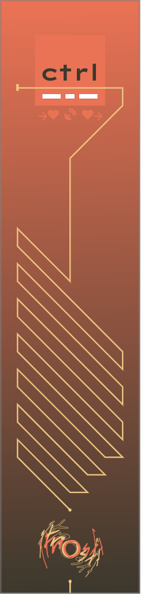
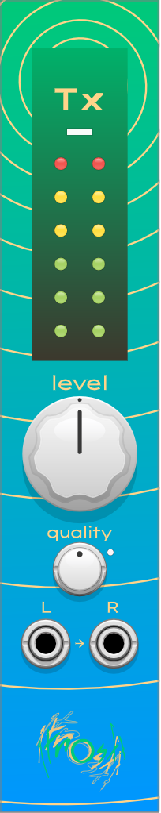

# gotnosoft brand modules for [VCV Rack](https://vcvrack.com/)

### ctrl

provides an [OSC](https://ccrma.stanford.edu/groups/osc/index.html)-based [API](API.md) for querying and controlling a VCV Rack patch.

the context menu provides a direct way to render a module (as the library does), or the module's panel and overlays separately. renders will land as pngs in `gotnosoft_ctrl_render` in your rack user directory.

### Tx

Tx- streams [opus](https://opus-codec.org/)-encoded audio over UDP. Acts as an expander to ctrl, which manages the stream and provides an api.
